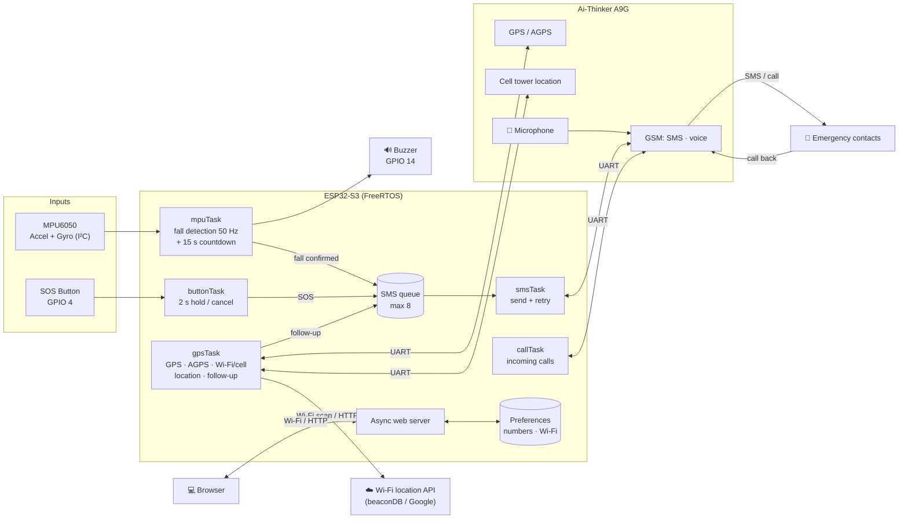
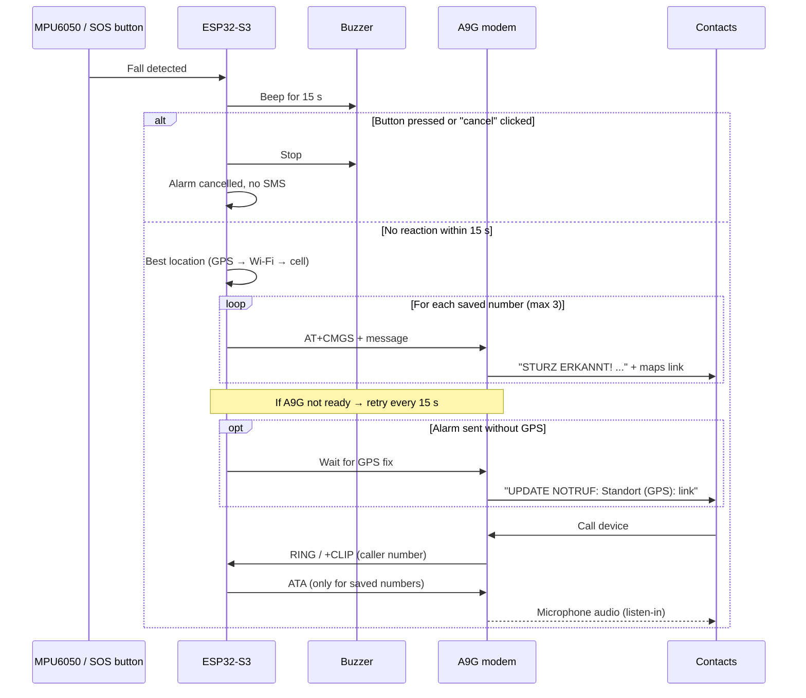
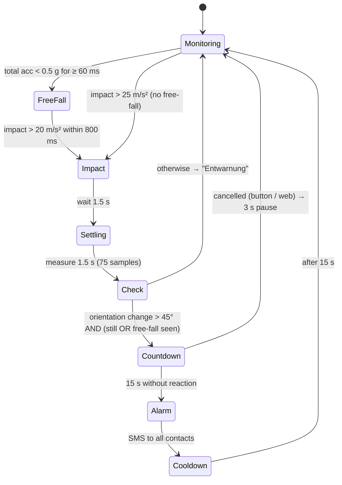

# 🆘 Fall Detection & SOS Device (ESP32-S3 + A9G + MPU6050)

A low-cost **personal emergency device** that detects falls automatically, has a **manual SOS button**, and sends an **SMS with the location** to up to **3 emergency contacts**. Contacts can **call the device back and listen** to what is happening around the person. Everything is configured and monitored through a built-in **web interface**.


> ⚠️ **Prototype – not a certified medical or safety device.** Do not rely on it as the only protection for a person at risk. See [Safety, privacy & legal notice](#%EF%B8%8F-safety-privacy--legal-notice).

---

## 📑 Table of Contents

1. [What is this project?](#-what-is-this-project)
2. [Features](#-features)
3. [System architecture](#%EF%B8%8F-system-architecture)
4. [Hardware](#-hardware)
5. [Circuit diagram & wiring](#-circuit-diagram--wiring)
6. [How fall detection works](#-how-fall-detection-works)
7. [How location works](#-how-location-works)
8. [Installation](#%EF%B8%8F-installation)
9. [Configuration](#-configuration)
10. [Usage](#-usage)
11. [Web interface & HTTP routes](#-web-interface--http-routes)
12. [Testing & tuning](#-testing--tuning)
13. [Troubleshooting](#%EF%B8%8F-troubleshooting)
14. [Project structure](#-project-structure)
15. [Project steps (development history)](#-project-steps-development-history)
16. [Roadmap](#%EF%B8%8F-roadmap)
17. [Safety, privacy & legal notice](#%EF%B8%8F-safety-privacy--legal-notice)
18. [License](#-license)

---

## 💡 What is this project?

Falls are one of the most common emergencies for elderly people and people living alone. Often the person cannot reach a phone afterwards.

This device is worn on the body (e.g. as a pendant or on the belt) and:

1. **Watches movement** continuously with an accelerometer/gyroscope (MPU6050).
2. **Recognises a fall** (free-fall → impact → changed body position → lying still).
3. **Gives the person 15 seconds to cancel** a false alarm (the buzzer beeps).
4. **Sends an SMS alarm** with a Google Maps link to all saved contacts via the A9G GSM/GPS module.
5. **Sends a precise GPS position later** if only an approximate position was available at alarm time.
6. **Answers calls from saved contacts automatically**, so they can listen through the microphone.
7. Lets the user **hold the SOS button for 2 seconds** to call for help manually at any time.

The goal of this prototype is to validate the concept before moving to a small production PCB (ESP32-S3 + LTE-M module, see [Roadmap](#%EF%B8%8F-roadmap)).

---

## ✨ Features

| Feature | Description |
|---|---|
| 🧍‍♂️➡️🛌 **Automatic fall detection** | Multi-stage algorithm at 50 Hz: free-fall, impact, orientation change, stillness check |
| ⏱️ **15 s cancel window** | After a detected fall the buzzer beeps for 15 s; a short button press or the web button cancels the alarm |
| 🔴 **SOS button** | Hold **2 seconds** to send an alarm. Immune to electrical noise from the GSM modem |
| 📩 **SMS alarm with retry** | Sent to up to 3 numbers; if the A9G is off or has no network, the SMS is retried every 15 s for up to 1 hour |
| 📍 **GPS + AGPS** | AGPS (assisted GPS over mobile data) for a faster first fix, normal GPS as fallback |
| 📶 **Approximate location** | Without a GPS fix: Wi-Fi location (when the device is on Wi-Fi) or cell tower location via the A9G |
| 🔁 **Location follow-up** | If the alarm had no GPS position, a second SMS with the exact GPS position is sent automatically as soon as GPS is available |
| 🎧 **Call-back & listen-in** | Calls from saved emergency numbers are answered automatically; other callers are rejected |
| 🌐 **Web interface** | Live location, sensor values, SMS status, phone numbers, Wi-Fi setup, cancel & hang-up buttons |
| 📡 **Setup access point** | If Wi-Fi fails, the device opens its own Wi-Fi `ESP32-SOS-Setup` for configuration |
| 🔌 **Modem auto-recovery** | Detects when the A9G is disconnected or restarted and sets it up again automatically |
| 💾 **Persistent settings** | Phone numbers and Wi-Fi data are kept after a restart (ESP32 Preferences) |
| 🧵 **FreeRTOS tasks** | Sensor, location, SMS, call, button and web server run in parallel, protected by mutexes |
| 🔁 **MPU clone support** | Detects compatible MPU6050 clones (e.g. MPU6500) via the `WHO_AM_I` register |

---

## 🏗️ System architecture



### Alarm flow



---

## 🧰 Hardware

### Bill of materials

| # | Part | Notes |
|---|---|---|
| 1 | **ESP32-S3** dev board | Main controller, Wi-Fi, web server |
| 1 | **Ai-Thinker A9G** board | GSM/GPRS (2G) + GPS, controlled with AT commands |
| 1 | **MPU6050** (GY-521) | 3-axis accelerometer + 3-axis gyroscope, I²C |
| 1 | **Push button** | SOS button (normally open) |
| 1 | **Active buzzer** | Countdown signal, on GPIO 14 |
| 1 | **NPN transistor** (e.g. S8050, 2N2222, BC337) + **1 kΩ** resistor | Drives the buzzer (recommended) |
| 1 | **Electret microphone** | For listen-in, on A9G MIC_P / MIC_N (only if your A9G board has no built-in mic) |
| 1 | **GSM antenna** | On the A9G GSM connector |
| 1 | **GPS antenna** | On the A9G GPS connector |
| 1 | **Nano SIM card** | SMS, voice calls and mobile data enabled, **no SIM PIN** |
| 2 | **Resistors** for voltage divider | e.g. 1 kΩ + 5.6 kΩ |
| 2 | **Capacitors** | 100 nF (button), 470–1000 µF (A9G power) |
| 1 | **Power supply** | LiPo 3.7 V (≥1000 mAh) or 5 V / 2 A supply |
| – | Breadboard, jumper wires | |

> 🔋 **Power is the most common problem.** The A9G draws current peaks of up to **~2 A** while transmitting. Never power it from the ESP32's 3.3 V pin.

---

## 🔌 Circuit diagram & wiring

### Block wiring

```
                          ┌──────────────────────────────┐
   ┌─────────────┐        │          ESP32-S3            │
   │  MPU6050    │        │                              │
   │ VCC ────────┼────────┤ 3V3                          │
   │ GND ────────┼────────┤ GND                          │
   │ SDA ────────┼────────┤ GPIO 8                       │
   │ SCL ────────┼────────┤ GPIO 9                       │
   └─────────────┘        │                              │
                          │                              │
   SOS button             │                              │
     o──┤├──o             │                              │
     │      └─────────────┤ GPIO 4  (INPUT_PULLUP)       │
     │      ┌─[100nF]─────┤ (cap between GPIO 4 and GND) │
     └──────┴─────────────┤ GND                          │
                          │                              │
                          │ GPIO 14 ──[1kΩ]──► B  NPN    │
   Buzzer (+) ── 5V/3V3   │                    C ◄── Buzzer (−)
                          │                    E ──► GND │
                          │                              │
                          │ GPIO 17 (TX2) ─[1kΩ]─┬───────┼────► A9G U_RXD
                          │                      │       │      (≈2.8 V)
                          │                   [5.6kΩ]    │
                          │                      │       │
                          │ GND ─────────────────┴───────┼────► A9G GND
                          │                              │
                          │ GPIO 16 (RX2) ◄──────────────┼───── A9G U_TXD
                          └──────────────────────────────┘

   Power:   LiPo 3.7 V / 5 V 2 A ──┬─► A9G VBAT / 5V-IN  (+ 470–1000 µF to GND)
                                   └─► ESP32-S3 5V / VIN
            ALL GROUNDS CONNECTED TOGETHER (ESP32, A9G, MPU6050, power)

   A9G:     GSM antenna ──► "GSM" connector
            GPS antenna ──► "GPS" connector
            Microphone  ──► MIC_P / MIC_N (if no built-in mic)
```

### Pin table

| ESP32-S3 | Connected to | Note |
|---|---|---|
| **GPIO 8** | MPU6050 SDA | `I2C_SDA` |
| **GPIO 9** | MPU6050 SCL | `I2C_SCL` |
| **GPIO 4** | SOS button → GND | `SOS_BUTTON_PIN`, internal pull-up, active LOW, 100 nF to GND |
| **GPIO 14** | Buzzer (via NPN transistor) | `BUZZER_PIN`, HIGH = beep |
| **GPIO 17** (TX2) | A9G **U_RXD** | `TXD2`, **through voltage divider** (3.3 V → ~2.8 V) |
| **GPIO 16** (RX2) | A9G **U_TXD** | `RXD2`, direct |
| 3V3 | MPU6050 VCC | |
| GND | All GNDs | **shared ground is mandatory** |

### Notes on the wiring

**Voltage divider:** The A9G UART works at **2.8 V**, the ESP32-S3 at **3.3 V**.

```
V_out = 3.3 V × 5.6k / (1k + 5.6k) ≈ 2.8 V
```

Measure the A9G RX pin before connecting: it should be **2.6–2.9 V** when idle. A level shifter module works too.

**Buzzer:** Use an **active** buzzer (it beeps by itself when powered). Small 3.3 V buzzers with less than ~20 mA may be connected directly to GPIO 14 → buzzer → GND. For louder 5 V buzzers, use the NPN transistor as shown.

**SOS button:** Check with a multimeter that GPIO 4 reads **~3.3 V when the button is not pressed**. If it reads 0 V, the 4-leg button is rotated by 90°: use two diagonally opposite legs.

---

## 🧠 How fall detection works

A simple "acceleration above X" check produces many false alarms (sitting down hard, jumping, dropping the device). This firmware uses several stages:



| Stage | What is checked | Parameter |
|---|---|---|
| Reference | Body orientation is tracked slowly while the person is calm (~1 g) | low-pass 0.95 / 0.05 |
| Free-fall | Total acceleration below 0.5 g | `FREEFALL_THRESHOLD`, `FREEFALL_MIN_MS` |
| Impact | Strong peak after (or without) free-fall | `IMPACT_THRESHOLD_AFTER_FF`, `FALL_THRESHOLD` |
| Position | Angle between gravity vector before and after the fall | `ORIENTATION_CHANGE_DEG` |
| Stillness | ≥ 80 % of samples near 1 g with low rotation | `STILL_ACC_DEV`, `STILL_GYRO` |
| Cancel window | Buzzer beeps, alarm can be stopped | `CANCEL_WINDOW_MS` |

Because the firmware compares the gravity vector before and after, **it does not matter how the device is mounted** (pendant, belt, pocket).

---

## 📍 How location works

The firmware always uses the **best location currently available**:

| Priority | Source | Typical accuracy | Needs |
|---|---|---|---|
| 1 | **GPS** (with AGPS if possible) | ~5–10 m | Sky view, GPS antenna |
| 2 | **Wi-Fi location** | ~20–100 m | Device connected to Wi-Fi with internet |
| 3 | **Cell tower location** (`AT+LOCATION=1`) | ~500 m – several km | Mobile data on the SIM, correct APN |

- Without a GPS fix, the approximate location is refreshed every **2 minutes** and is used for at most **15 minutes**.
- The alarm SMS shows the source, e.g. `Ca.-Standort (WLAN, ~40 m): https://maps.google.com/?q=…`.
- **Follow-up:** if the alarm was sent without GPS, the device checks GPS every 10 s and sends `UPDATE NOTRUF: Standort (GPS): …` as soon as a fix is available (for up to 2 hours).

> 📌 **Current limitation:** Wi-Fi location only works where the ESP32 is connected to a known Wi-Fi with internet (e.g. at home). **Outside**, the device uses **GPS → cell tower**. Wi-Fi location over mobile data (A9G + relay server) is planned, see [Roadmap](#%EF%B8%8F-roadmap).

---

## ⚙️ Installation

### 1. Prepare the SIM card

- Insert the SIM in a normal phone first.
- **Disable the SIM PIN.**
- Make sure **SMS, voice calls and mobile data** work and the SIM has credit.
- Find out the **APN** of your provider (e.g. `web.vodafone.de`, `online.telia.se`, `internet`).
- Insert it into the A9G (power off!).

> 📶 The A9G uses **2G (GSM/GPRS)**. Check that 2G is still available from your network operator in your country.

### 2. Install the software

1. Install the **[Arduino IDE 2.x](https://www.arduino.cc/en/software)**.
2. Add the ESP32 board package:
   - *File → Preferences → Additional boards manager URLs:*
     ```
     https://espressif.github.io/arduino-esp32/package_esp32_index.json
     ```
   - *Tools → Board → Boards Manager* → search **esp32** (by Espressif) → **Install**.
3. Install the libraries (*Tools → Manage Libraries*):

| Library | Purpose |
|---|---|
| **Adafruit MPU6050** | Sensor driver |
| **Adafruit Unified Sensor** | Sensor base library |
| **Adafruit BusIO** | Installed automatically |
| **ESPAsyncWebServer** (ESP32Async) | Web server |
| **AsyncTCP** (ESP32Async) | Required by ESPAsyncWebServer |

`WiFi`, `HTTPClient`, `WiFiClientSecure`, `Preferences`, `Wire` and FreeRTOS are part of the ESP32 core.

### 3. Get the code

```bash
git clone https://github.com/glena04/<repository-name>.git
cd <repository-name>
```

Open `Web-GPS-GSM/Web-GPS-GSM.ino` in the Arduino IDE.

### 4. Board settings

| Setting | Value |
|---|---|
| Board | ESP32S3 Dev Module |
| USB CDC On Boot | Enabled (Serial Monitor over USB) |
| Upload speed | 921600 |
| Flash size | according to your board |

### 5. Upload

1. Connect the ESP32-S3 by USB and select the port (*Tools → Port*).
2. Click **Upload**.
3. Open the **Serial Monitor** at **115200 baud**.

---

## 🔧 Configuration

All settings are at the top of `Web-GPS-GSM.ino`.

### Wi-Fi & setup access point

```cpp
const char* DEFAULT_SSID = "DEIN_WLAN_NAME";      // or set later on the web page
const char* DEFAULT_PASS = "DEIN_WLAN_PASSWORT";
const char* AP_SSID      = "ESP32-SOS-Setup";     // setup Wi-Fi if connection fails
const char* AP_PASS      = "sos12345";
```

> 🔐 **Never push real passwords to GitHub.** Keep placeholders in the repository and enter your data on the web page, or use a `secrets.h` listed in `.gitignore`.

### Pins

| Constant | Default | Meaning |
|---|---|---|
| `RXD2` / `TXD2` | 16 / 17 | UART to the A9G |
| `SOS_BUTTON_PIN` | 4 | SOS button |
| `BUZZER_PIN` | 14 | Buzzer (`-1` = none) |
| `I2C_SDA` / `I2C_SCL` | 8 / 9 | MPU6050 |

### Alarm & button

| Constant | Default | Meaning |
|---|---|---|
| `CANCEL_WINDOW_MS` | 15000 | Time to cancel a fall alarm |
| `SOS_HOLD_MS` | 2000 | How long the button must be held for SOS |
| `CANCEL_HOLD_MS` | 100 | Short press to cancel during the countdown |
| `SOS_LOCKOUT_MS` | 60000 | Lock after a button SOS |

### SMS

| Constant | Default | Meaning |
|---|---|---|
| `SMS_RETRY_INTERVAL_MS` | 15000 | Retry interval when the A9G is not ready |
| `SMS_MAX_RETRY_MS` | 3600000 | Give up after 1 hour |
| `SMS_SEND_TIMEOUT_MS` | 15000 | Wait for `+CMGS` confirmation |

### Location

| Constant | Default | Meaning |
|---|---|---|
| `GPRS_APN` | `"internet"` | **APN of your SIM – change this!** |
| `USE_AGPS` | `true` | Assisted GPS (needs mobile data) |
| `USE_WIFI_LOCATION` | `true` | Wi-Fi location |
| `USE_CELL_LOCATION` | `true` | Cell tower location |
| `GEO_API_URL` | beaconDB | Wi-Fi location service (free, experimental). Alternative: Google Geolocation API with key |
| `FALLBACK_INTERVAL_MS` | 120000 | Refresh approximate location every 2 min |
| `FALLBACK_MAX_AGE_MS` | 900000 | Use approximate location for max. 15 min |
| `FOLLOWUP_MAX_MS` | 7200000 | Send GPS follow-up for up to 2 h |

### Call-back / listen-in

| Constant | Default | Meaning |
|---|---|---|
| `LISTEN_IN_ENABLED` | `true` | Answer calls from saved numbers automatically |
| `MUTE_SPEAKER` | `true` | Caller only listens (`AT+CLVL=0`) |

### Fall detection

```cpp
const float FALL_THRESHOLD            = 25.0;   // impact without free-fall (m/s²)
const float IMPACT_THRESHOLD_AFTER_FF = 20.0f;  // impact after free-fall (m/s²)
const float ORIENTATION_CHANGE_DEG    = 45.0f;  // body angle change (°)
const float STILL_GYRO                = 0.5f;   // rad/s
```

---

## 📱 Usage

### First start

1. Power the device. The Serial Monitor shows:
   ```
   MPU6050 erfolgreich initialisiert.
   Verbunden! IP-Adresse: 192.168.x.x
   A9G erreichbar - wird eingerichtet.
   GPRS aktiv.
   AGPS aktiv.
   ```
2. **If Wi-Fi fails**, connect your phone to the Wi-Fi **`ESP32-SOS-Setup`** (password `sos12345`), open **http://192.168.4.1** and enter your Wi-Fi data.
3. Open the device IP in a browser and **save up to 3 emergency numbers** (international format, e.g. `+4917612345678`).
4. Place the GPS antenna with a clear view of the sky (first fix can take several minutes; AGPS makes it faster).

### Sending an alarm

| Trigger | What happens | SMS text |
|---|---|---|
| **Fall detected** | Buzzer beeps 15 s → if not cancelled, SMS to all numbers | `STURZ ERKANNT! Ich brauche Hilfe. Standort (GPS): …` |
| **SOS button held 2 s** | SMS to all numbers immediately | `NOTRUF! Ich brauche Hilfe. Standort (GPS): …` |
| **Web "SOS" button** | SMS to all numbers immediately | same as above |
| **GPS becomes available later** | Follow-up SMS | `UPDATE NOTRUF: Standort (GPS): …` |

### Cancelling a false fall alarm

During the 15 s countdown (buzzer beeping):
- **press the SOS button briefly**, or
- click **"⛔ Sturzalarm abbrechen"** on the web page.

The web status shows `Sturzalarm abgebrochen – kein Notruf gesendet.`

### Calling the device (listen-in)

1. Call the **phone number of the device's SIM** from one of the saved emergency numbers.
2. The device answers automatically. You hear the surroundings through the microphone.
3. Calls from other numbers are rejected.
4. End the call on your phone or click **"📴 Laufenden Anruf beenden"** on the web page.

### When the A9G has no network

The SMS stays in the queue. The web status shows:

```
Warte auf A9G: +49176… (A9G nicht bereit oder kein Netz) – neuer Versuch alle 15 s.
SMS gesendet an: +49176… (Versuch 4)
```

---

## 🌐 Web interface & HTTP routes

| Route | Method | Purpose |
|---|---|---|
| `/` | GET | Main page |
| `/getLocation` | GET | Current location (GPS or approximate) |
| `/getMPU` | GET | Sensor values as JSON |
| `/getSMSStatus` | GET | Status text (SMS, countdown, calls) |
| `/sos` | GET | Send SOS to all numbers |
| `/cancel` | GET | Cancel a running fall countdown |
| `/hangup` | GET | End the current call |
| `/sendSMS?number=…&message=…` | GET | Send a manual SMS with location |
| `/savePhones?p1=…&p2=…&p3=…` | GET | Save emergency numbers |
| `/saveWifi?ssid=…&pass=…` | GET | Save Wi-Fi data and restart |

> 🔒 The web interface has **no login** yet. Only use it in a trusted network.

---

## 🧪 Testing & tuning

Never test by actually falling. Use safe tests and watch the Serial Monitor:

```
Aufprall 31.4 m/s^2 (Freifall: ja) - pruefe Lage...
Lageaenderung 78 Grad, ruhig: ja
Sturz erkannt - starte Abbruch-Countdown.
Sturzalarm in 15 s - Taster druecken zum Abbrechen
```

| Test | Expected result |
|---|---|
| Drop device onto a mattress / pillow | ✅ Countdown + buzzer |
| Press button during countdown | ✅ "Sturzalarm abgebrochen" |
| Wait 15 s after countdown starts | ✅ SMS sent |
| Sit down hard on a chair | ❌ "Entwarnung: kein Sturz." |
| Walk, climb stairs, jump | ❌ No alarm |
| Tap SOS button briefly | ❌ No alarm (needs 2 s) |
| Hold SOS button 2 s | ✅ SMS sent |
| Unplug A9G, press SOS, plug back in | ✅ SMS sent after the A9G is back |
| Call device from a saved number | ✅ Answered, listen-in works |
| Call from an unknown number | ❌ Rejected |
| Indoors without GPS fix | ✅ SMS with `Ca.-Standort (WLAN …)` or `(Funkzelle …)`, later GPS follow-up |

**Tip:** Use only your own number while testing.

---

## 🛠️ Troubleshooting

| Problem | Possible cause | Solution |
|---|---|---|
| `MPU6050 nicht gefunden!` | Wiring / clone chip | Check SDA=8, SCL=9; look at `MPU WHO_AM_I = 0x..` |
| SOS sent without pressing the button | Noise from the A9G on GPIO 4 / wrong button wiring | Use v7.1+, 100 nF capacitor, short wires; GPIO 4 must read ~3.3 V when released |
| No response to AT commands | TX/RX swapped, no shared GND | Swap TX/RX, connect grounds, check divider voltage |
| `keine Bereitschaft ('>')` | A9G off, no network, SIM PIN active | Check power, antenna, SIM; SMS is retried automatically |
| A9G restarts when sending | Power supply too weak | LiPo or 5 V / 2 A, 470–1000 µF capacitor near the A9G |
| `+CIEV: "SMSFULL"` | SIM SMS storage full | Send `AT+CMGD=1,4` once (deletes all stored SMS) |
| `GPRS fehlgeschlagen` | Wrong APN / no mobile data | Set `GPRS_APN`, check data plan |
| `AGPS nicht moeglich` | No mobile data / AGPS server unreachable | Device uses normal GPS automatically |
| `WLAN-Ortung fehlgeschlagen: HTTP …` | Service unreachable / no data for the area | Normal for beaconDB in some areas; cell location is used instead |
| Cell location is far away | Cell tower location is coarse | Expected; GPS follow-up is sent later |
| Latitude and longitude look swapped | Different response format | Check `A9G Funkzellen-Antwort:` in the log and open an issue |
| Call not answered | Number not saved / caller ID hidden | Save the caller's number; do not hide caller ID |
| Nothing heard in the call | No microphone connected | Connect an electret mic to A9G MIC_P / MIC_N |
| Buzzer silent | Passive buzzer / too weak GPIO | Use an **active** buzzer and the NPN transistor |
| ESP32 crashes / reboots | Stack overflow | `mpuTask` 8192, `gpsTask` 10240 bytes |

Useful AT commands for manual checks:

```
AT              → OK (modem responds)
AT+CPIN?        → READY (SIM ok, no PIN)
AT+CSQ          → signal quality (10–31 is good)
AT+CREG?        → x,1 or x,5 = registered
AT+CGATT=1      → attach mobile data
AT+AGPS=1       → assisted GPS on
AT+LOCATION=1   → cell tower location
AT+LOCATION=2   → GPS location
AT+CMGD=1,4     → delete all stored SMS
```

---

## 📁 Project structure

Current (single sketch):

```
Web-GPS-GSM/
└── Web-GPS-GSM.ino      # firmware v7.3
docs/
└── images/              # photos, wiring pictures
README.md
LICENSE
```

Planned modular structure:

```
Web-GPS-GSM/
├── Web-GPS-GSM.ino       # setup(), loop(), task creation
├── config.h              # pins, thresholds, timings
├── secrets.h             # Wi-Fi password, API key (in .gitignore)
├── webpage.h             # HTML page
├── web_handlers.cpp/.h   # HTTP routes
├── modem.cpp/.h          # A9G: AT commands, URC parser, SMS task
├── location.cpp/.h       # GPS, AGPS, Wi-Fi & cell location, follow-up
├── calls.cpp/.h          # call-back / listen-in
├── fall_detection.cpp/.h # mpuTask, countdown
└── sos.cpp/.h            # button task, SMS queue helpers
```

---

## 🪜 Project steps (development history)

| Version / step | What was done |
|---|---|
| Research | Compared nRF9151, ESP32 + Quectel BG95-M3, SIMCom A7670E, A9G. Chose ESP32 + A9G for a cheap first prototype |
| Wiring | ESP32 ↔ A9G over UART, 3.3 V / 2.8 V voltage divider, power for 2 A peaks |
| Modem tests | AT commands for SMS and GPS; status LED stays on the ESP32 |
| Web interface | Phone numbers, GPS, sensor values, status, Wi-Fi setup with access point |
| SOS button | Manual alarm with SMS queue for up to 3 numbers |
| Fall detection v1 | Simple impact threshold at 10 Hz → too many false alarms |
| **v6** | New algorithm at 50 Hz: free-fall + impact + orientation change + stillness |
| **v6.1** | MPU6050 clone support (`WHO_AM_I`), ±8 g range, bigger task stack |
| **v7** | 15 s cancel window, call-back & listen-in, modem URC parser |
| **v7.1** | Noise-proof SOS button (2 s hold, polling instead of interrupt, 60 s lock) – fixed endless SMS loop |
| **v7.2** | SMS retry queue, modem readiness check, `+CMGS` confirmation, automatic A9G re-setup |
| **v7.3** | AGPS, Wi-Fi & cell tower location, GPS follow-up SMS, buzzer on GPIO 14 |
| Product planning | Configuration by SMS / web portal, hosting (VPS + MQTT), cost estimate for a custom PCB |

---

## 🗺️ Roadmap

- [x] ESP32 + A9G + MPU6050 prototype
- [x] Web interface and SOS button
- [x] Multi-stage fall detection
- [x] 15 s cancel window with buzzer
- [x] Call-back & listen-in
- [x] SMS retry queue
- [x] AGPS, Wi-Fi & cell tower location, GPS follow-up
- [ ] **v7.4:** Wi-Fi location **outside the home** – scan sent over the A9G to a small relay (`locate.php`) that calls the location service over HTTPS
- [ ] Audible signal when a call is answered (transparency for the wearer)
- [ ] Login for the web interface
- [ ] Configure phone numbers by **SMS commands** (PIN + sender whitelist)
- [ ] Low battery warning by SMS
- [ ] Split firmware into modules / move to PlatformIO
- [ ] Replace A9G (2G) with **Quectel BG95-M3** (LTE-M / NB-IoT + GNSS)
- [ ] Replace MPU6050 with **ST LSM6DSOX** (on-chip free-fall & ML core) + LIS3MDL
- [ ] Custom **PCB** with ESP32-S3, BG95-M3, GNSS and IMU in a small wearable case
- [ ] Optional cloud portal (VPS + MQTT) for relatives / care services

---

## ⚠️ Safety, privacy & legal notice

**Safety**
- This is a **hobby / research prototype**, **not** a certified medical device or emergency alarm system.
- Falls can be missed and false alarms can happen.
- 2G networks are being shut down in many countries; without network coverage **no alarm is sent**.
- The device does **not** call emergency services (112) automatically.
- A commercial product would need CE marking (RED), radiation (SAR) testing and possibly a medical device assessment.

**Listen-in**
- Secretly listening to or recording spoken words of others is a **criminal offence** in many countries (e.g. Germany: §201 StGB).
- The **wearer must know about and agree to** the listen-in function. Inform people around the wearer where required.

**Location privacy**
- For Wi-Fi location, the **MAC addresses and signal strengths of nearby Wi-Fi networks** are sent to an external service (default: beaconDB).
- Location data is sent by SMS to the saved contacts only.

---

## 📄 License

This project is licensed under the **MIT License** – see [LICENSE](LICENSE).

---

## 👤 Author

**Star** – [Glesta Digital](https://dev.glesta.net) · GitHub: [@glena04](https://github.com/glena04)

Contributions, issues and ideas are welcome! ⭐ If this project helps you, please give it a star.
