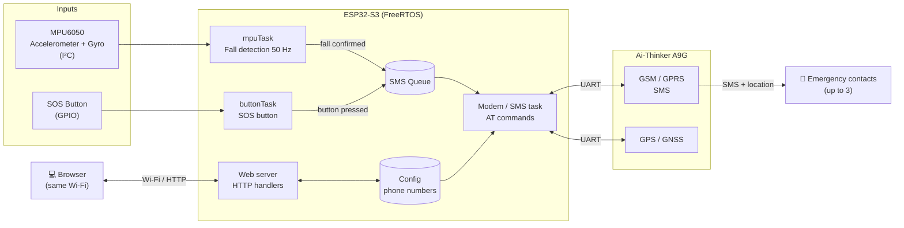
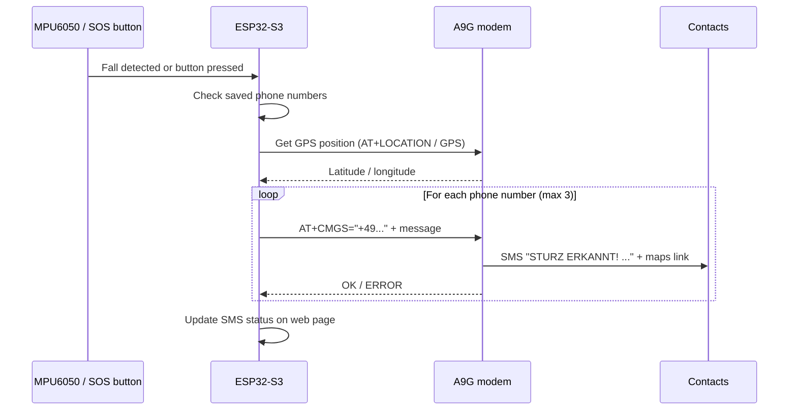
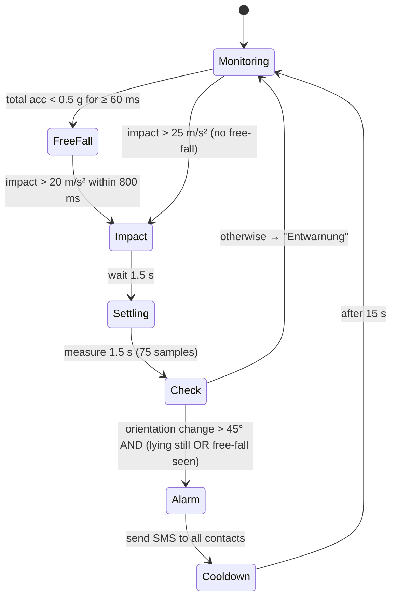

# 🆘 Fall Detection & SOS Device (ESP32-S3 + A9G + MPU6050)

A low-cost **personal emergency device** that detects falls automatically, has a **manual SOS button**, and sends an **SMS with the GPS position** to up to **3 emergency contacts**. Everything is configured and monitored through a built-in **web interface**.


> ⚠️ **Prototype – not a certified medical or safety device.** Do not rely on it as the only protection for a person at risk. See [Safety notice](#-safety-notice).

---

## 📑 Table of Contents

1. [What is this project?](#-what-is-this-project)
2. [Features](#-features)
3. [System architecture](#-system-architecture)
4. [Hardware](#-hardware)
5. [Circuit diagram & wiring](#-circuit-diagram--wiring)
6. [How fall detection works](#-how-fall-detection-works)
7. [Installation](#-installation)
8. [Configuration](#-configuration)
9. [Usage](#-usage)
10. [Testing & tuning](#-testing--tuning)
11. [Troubleshooting](#-troubleshooting)
12. [Project structure](#-project-structure)
13. [Project steps (development history)](#-project-steps-development-history)
14. [Roadmap](#-roadmap)
15. [Safety notice](#-safety-notice)
16. [License](#-license)

---

## 💡 What is this project?

Falls are one of the most common emergencies for elderly people and people living alone. Often the person cannot reach a phone afterwards.

This device is worn on the body (e.g. as a pendant or on the belt) and:

1. **Watches movement** continuously with an accelerometer/gyroscope (MPU6050).
2. **Recognises a fall** (free-fall → impact → changed body position → lying still).
3. **Sends an SMS alarm** with a Google Maps link to all saved contacts via the A9G GSM/GPS module.
4. Lets the user **press the SOS button** to call for help manually at any time.

The goal of this prototype is to validate the concept before moving to a small production PCB (ESP32-S3 + LTE-M module, see [Roadmap](#-roadmap)).

---

## ✨ Features

| Feature | Description |
|---|---|
| 🧍‍♂️➡️🛌 **Automatic fall detection** | Multi-stage algorithm at 50 Hz: free-fall, impact, orientation change, stillness check |
| 🔴 **SOS button** | Manual alarm with one press |
| 📩 **SMS alarm** | Sent to up to 3 phone numbers, queued and sent one after another |
| 📍 **GPS position** | Location from the A9G GNSS, included in the alarm |
| 🌐 **Web interface** | Live sensor values, GPS status, SMS status, phone number setup |
| 💾 **Persistent settings** | Phone numbers and config are kept after a restart |
| 🧵 **FreeRTOS tasks** | Sensor, modem, button and web server run in parallel, protected by a mutex |
| 🔁 **MPU clone support** | Detects compatible MPU6050 clones (e.g. MPU6500) via the `WHO_AM_I` register |
| ⏱️ **Alarm cooldown** | 15 s cooldown after an alarm to avoid duplicate messages |

---

## 🏗️ System architecture



### Alarm flow



---

## 🧰 Hardware

### Bill of materials

| # | Part | Notes |
|---|---|---|
| 1 | **ESP32-S3** dev board | Main controller, Wi-Fi, web server |
| 1 | **Ai-Thinker A9G** board | GSM/GPRS (2G) + GPS, controlled with AT commands |
| 1 | **MPU6050** (GY-521) | 3-axis accelerometer + 3-axis gyroscope, I²C |
| 1 | **Push button** | SOS button (normally open) |
| 1 | **GSM antenna** | Connect to the A9G GSM connector |
| 1 | **GPS antenna** | Active or passive GPS antenna on the A9G GPS connector |
| 1 | **Nano SIM card** | With SMS enabled and **no SIM PIN** |
| 2 | **Resistors** for voltage divider | e.g. 1 kΩ + 5.6 kΩ (see wiring) |
| 1 | **Power supply** | LiPo 3.7 V (≥1000 mAh) or 5 V / 2 A supply |
| – | Breadboard, jumper wires | |

> 🔋 **Power is the most common problem.** The A9G draws current peaks of up to **~2 A** while transmitting. Never power it from the ESP32's 3.3 V pin.

---

## 🔌 Circuit diagram & wiring

### Block wiring

```
                          ┌──────────────────────────┐
                          │       ESP32-S3           │
   ┌─────────────┐        │                          │
   │  MPU6050    │        │                          │
   │ VCC ────────┼────────┤ 3V3                      │
   │ GND ────────┼────────┤ GND                      │
   │ SDA ────────┼────────┤ GPIO 8   (I2C_SDA)       │
   │ SCL ────────┼────────┤ GPIO 9   (I2C_SCL)       │
   └─────────────┘        │                          │
                          │                          │
   SOS Button             │                          │
   ┌──o  o──┐             │                          │
   │        └─────────────┤ GPIO SOS_BUTTON_PIN      │  (INPUT_PULLUP)
   └──────────────────────┤ GND                      │
                          │                          │
                          │  MODEM_TX ──[1kΩ]──┬─────┼──────► A9G U_RXD
                          │                    │     │
                          │                  [5.6kΩ] │   (≈2.8 V level)
                          │                    │     │
                          │  GND ──────────────┴─────┼──────► A9G GND
                          │                          │
                          │  MODEM_RX ◄──────────────┼─────── A9G U_TXD
                          └──────────────────────────┘

   Power:   LiPo 3.7 V / 5 V 2 A ──► A9G VBAT / 5V-IN
                                 └─► ESP32-S3 5V / VIN
            ALL GROUNDS CONNECTED TOGETHER (ESP32, A9G, MPU6050, power)

   Antennas: GSM antenna ──► A9G "GSM" connector
             GPS antenna ──► A9G "GPS" connector
```

### Pin table

| From | To | Note |
|---|---|---|
| MPU6050 VCC | ESP32-S3 3V3 | |
| MPU6050 GND | GND | |
| MPU6050 SDA | **GPIO 8** | `I2C_SDA` |
| MPU6050 SCL | **GPIO 9** | `I2C_SCL` |
| SOS button pin 1 | `SOS_BUTTON_PIN` | internal pull-up, active LOW |
| SOS button pin 2 | GND | |
| ESP32 `MODEM_TX` | A9G **U_RXD** | **through voltage divider** (3.3 V → ~2.8 V) |
| ESP32 `MODEM_RX` | A9G **U_TXD** | direct (2.8 V is read as HIGH by the ESP32) |
| ESP32 GND | A9G GND | **shared ground is mandatory** |
| Power supply | A9G VBAT / 5V | must deliver ~2 A peaks |

> 📌 The exact GPIO numbers for `MODEM_TX`, `MODEM_RX` and `SOS_BUTTON_PIN` are defined at the top of `Web-GPS-GSM.ino`. Check them there and wire accordingly.

### Why the voltage divider?

The A9G UART works at **2.8 V**, the ESP32-S3 at **3.3 V**. The divider lowers the ESP32 TX signal:

```
V_out = 3.3 V × R2 / (R1 + R2) = 3.3 × 5.6k / (1k + 5.6k) ≈ 2.8 V
```

Measure the voltage on the A9G RX pin with a multimeter before connecting: it should be **2.6–2.9 V** when idle. A level shifter module works too.

---

## 🧠 How fall detection works

A simple "acceleration above X" check produces many false alarms (sitting down hard, jumping, dropping the device). This firmware uses **four stages**:



| Stage | What is checked | Parameter |
|---|---|---|
| 1. Reference | Body orientation is tracked slowly while the person is calm (~1 g) | low-pass filter 0.95 / 0.05 |
| 2. Free-fall | Total acceleration drops below 0.5 g | `FREEFALL_THRESHOLD`, `FREEFALL_MIN_MS` |
| 3. Impact | Strong peak after (or without) free-fall | `IMPACT_THRESHOLD`, `IMPACT_THRESHOLD_AFTER_FF` |
| 4. Position | Angle between gravity vector **before** and **after** the fall | `ORIENTATION_CHANGE_DEG` |
| 5. Stillness | ≥ 80 % of samples near 1 g with low rotation | `STILL_ACC_DEV`, `STILL_GYRO` |

Because the firmware compares the gravity vector before and after, it **does not matter how the device is mounted** (pendant, belt, pocket).

---

## ⚙️ Installation

### 1. Prepare the SIM card

- Insert the SIM in a normal phone first.
- **Disable the SIM PIN.**
- Check that the SIM can send SMS and has credit.
- Insert it into the A9G (power off!).

> 📶 The A9G uses **2G (GSM/GPRS)**. Check that 2G is still available from your network operator in your country.

### 2. Install the software

1. Install the **[Arduino IDE 2.x](https://www.arduino.cc/en/software)**.
2. Add the ESP32 board package:
   - *File → Preferences → Additional boards manager URLs:*
     ```
     https://espressif.github.io/arduino-esp32/package_esp32_index.json
     ```
   - *Tools → Board → Boards Manager* → search **esp32** (by Espressif) → **Install**.
3. Install the libraries (*Tools → Manage Libraries*):
   - **Adafruit MPU6050**
   - **Adafruit Unified Sensor**
   - **Adafruit BusIO** (installed automatically as a dependency)

`WiFi`, `WebServer`, `Wire` and FreeRTOS are already part of the ESP32 core.

### 3. Get the code

```bash
git clone https://github.com/glena04/<repository-name>.git
cd <repository-name>
```

Open `Web-GPS-GSM/Web-GPS-GSM.ino` in the Arduino IDE.

### 4. Board settings

| Setting | Value |
|---|---|
| Board | ESP32S3 Dev Module |
| USB CDC On Boot | Enabled (for Serial Monitor over USB) |
| Upload speed | 921600 |
| Flash size | according to your board |

### 5. Upload

1. Connect the ESP32-S3 by USB.
2. Select the correct port (*Tools → Port*).
3. Click **Upload**.
4. Open the **Serial Monitor** at **115200 baud**.

---

## 🔧 Configuration

All important settings are at the top of `Web-GPS-GSM.ino`:

```cpp
// Wi-Fi (replace before use – never push real passwords to GitHub!)
const char* DEFAULT_SSID = "YOUR_WIFI_NAME";
const char* DEFAULT_PASS = "YOUR_WIFI_PASSWORD";

// I2C pins for MPU6050
#define I2C_SDA 8
#define I2C_SCL 9

// Fall detection
const float FALL_THRESHOLD            = 25.0;   // impact without free-fall (m/s²)
const float IMPACT_THRESHOLD_AFTER_FF = 20.0f;  // impact after free-fall (m/s²)
const float ORIENTATION_CHANGE_DEG    = 45.0f;  // body angle change (°)
```

> 🔐 **Security:** replace your real Wi-Fi password with a placeholder before committing. Consider a `secrets.h` file that is listed in `.gitignore`.

---

## 📱 Usage

### First start

1. Power the device (A9G first, or both together).
2. Watch the Serial Monitor. You should see something like:
   ```
   MPU6050 erfolgreich initialisiert.
   WiFi verbunden: 192.168.x.x
   ```
3. Wait until the A9G LED shows the network is registered (usually 10–60 s).
4. Place the GPS antenna with a clear view of the sky (first fix can take several minutes).

### Web interface

Open the IP address from the Serial Monitor in a browser on the same Wi-Fi network:

```
http://192.168.x.x
```

| Section | What you can do |
|---|---|
| 📞 Phone numbers | Save up to **3** emergency numbers (international format, e.g. `+4917612345678`) |
| 📍 GPS | See fix status and current coordinates |
| 📈 MPU6050 | Live accelerometer & gyroscope values (move the device to see changes) |
| 📩 SMS status | See whether the last alarm was sent |

### Sending an alarm

| Trigger | What happens |
|---|---|
| **SOS button** pressed | SMS alarm is sent immediately to all saved numbers |
| **Fall detected** | SMS `STURZ ERKANNT! Ich brauche Hilfe.` + position to all saved numbers |
| No number saved | Web status shows `STURZ ERKANNT, aber keine Nummer gespeichert!` |

---

## 🧪 Testing & tuning

Never test by actually falling. Use safe tests and watch the Serial Monitor:

```
Aufprall 31.4 m/s^2 (Freifall: ja) - pruefe Lage...
Lageaenderung 78 Grad, ruhig: ja
SOS: Sturz bestaetigt!
```

| Test | Expected result |
|---|---|
| Drop device onto a mattress / pillow | ✅ Alarm |
| Wear it and lie down quickly on a bed | ✅ Alarm (or close to threshold) |
| Sit down hard on a chair | ❌ "Entwarnung: kein Sturz." |
| Walk, climb stairs, jump | ❌ No alarm |
| Lie down slowly | ❌ No alarm |
| Press the SOS button | ✅ Alarm |

Adjust `ORIENTATION_CHANGE_DEG`, `IMPACT_THRESHOLD_AFTER_FF` and `STILL_GYRO` until you get a good balance between missed falls and false alarms. **Tip:** Remove the phone numbers (or use your own) while testing.

---

## 🛠️ Troubleshooting

| Problem | Possible cause | Solution |
|---|---|---|
| `MPU6050 nicht gefunden!` | Wrong wiring / clone chip | Check SDA=8, SCL=9. Look at `MPU WHO_AM_I = 0x..` in the log; clones are supported from v6.1 |
| MPU values on web page don't change | `mpuTask` stopped | Check Serial log for `mpuTask beendet`; check I²C wiring |
| Fall never detected | Sensor range ±2 g | v6.1 sets ±8 g; make sure init succeeded |
| No response to AT commands | TX/RX swapped, no shared GND, wrong baud | Swap TX/RX, connect grounds, check divider voltage |
| A9G restarts when sending SMS | Power supply too weak | Use LiPo or 5 V / 2 A, add a 470–1000 µF capacitor near the A9G |
| SMS not sent | SIM PIN active, no credit, no 2G coverage | Disable PIN, check credit, check `AT+CREG?` / `AT+CSQ` |
| No GPS fix | Antenna indoors / not connected | Place antenna near a window or outside, wait several minutes |
| ESP32 crashes / reboots | Task stack overflow | v6.1 uses 8192 bytes for `mpuTask` |

Useful AT commands for manual checks:

```
AT          → OK (modem responds)
AT+CPIN?    → READY (SIM ok, no PIN)
AT+CSQ      → signal quality (10–31 is good)
AT+CREG?    → 0,1 or 0,5 = registered
AT+GPS=1    → turn on GPS
AT+LOCATION=2 → read GPS position
```

---

## 📁 Project structure

Current (single sketch):

```
Web-GPS-GSM/
└── Web-GPS-GSM.ino      # firmware v6.1 (~900 lines)
docs/
└── images/              # photos, wiring pictures (optional)
README.md
LICENSE
```

Planned modular structure:

```
Web-GPS-GSM/
├── Web-GPS-GSM.ino       # setup(), loop(), task creation
├── config.h              # pins, thresholds, Wi-Fi defaults
├── secrets.h             # Wi-Fi password (in .gitignore)
├── webpage.h             # HTML page
├── web_handlers.cpp/.h   # HTTP routes
├── modem.cpp/.h          # A9G: AT commands, GPS, SMS task
├── fall_detection.cpp/.h # mpuTask + helpers
└── sos.cpp/.h            # SOS button, enqueueSOSForAllNumbers()
```

---

## 🪜 Project steps (development history)

| Step | What was done |
|---|---|
| 1. Research | Compared MCU and modem options: nRF9151, ESP32 + Quectel BG95-M3, SIMCom A7670E, A9G. Chose ESP32 + A9G for a cheap first prototype |
| 2. Wiring | Connected ESP32 ↔ A9G over UART, solved 3.3 V / 2.8 V level mismatch with a voltage divider, fixed power for 2 A peaks |
| 3. Modem tests | Tested AT commands for SMS and GPS; A9G LED control via AT not possible → status LED stays on the ESP32 |
| 4. Web interface | Built web server for phone numbers, GPS, sensor values and status |
| 5. SOS button | Manual alarm with SMS queue for up to 3 numbers |
| 6. Fall detection v1 | Simple impact threshold (25 m/s²) at 10 Hz → too many false alarms, missed peaks |
| 7. Fall detection v6 | New algorithm at 50 Hz: free-fall + impact + orientation change + stillness |
| 8. v6.1 | MPU6050 clone support (`WHO_AM_I`), ±8 g range now always applied, bigger task stack |
| 9. Product planning | Architecture for configuration (SMS commands, web portal), hosting (VPS + MQTT), cost estimate for a custom PCB |

---

## 🗺️ Roadmap

- [x] ESP32 + A9G + MPU6050 prototype
- [x] Web interface and SOS button
- [x] Multi-stage fall detection (v6.1)
- [ ] **Cancel window**: 15–30 s countdown with buzzer/LED to cancel a false alarm
- [ ] Split firmware into modules / move to PlatformIO
- [ ] Configure phone numbers by **SMS commands** (PIN + sender whitelist)
- [ ] Low battery warning by SMS
- [ ] Replace A9G (2G) with **Quectel BG95-M3** (LTE-M / NB-IoT + GNSS)
- [ ] Replace MPU6050 with **ST LSM6DSOX** (on-chip free-fall & ML core) + LIS3MDL
- [ ] Custom **PCB** with ESP32-S3, BG95-M3, GNSS and IMU in a small wearable case
- [ ] Optional cloud portal (VPS + MQTT) for relatives / care services

---

## ⚠️ Safety notice

- This is a **hobby / research prototype**, **not** a certified medical device or emergency alarm system.
- Falls can be missed and false alarms can happen.
- 2G networks are being shut down in many countries; without network coverage **no alarm is sent**.
- The device does **not** call emergency services (112) automatically.
- A commercial product would need CE marking (RED), radiation (SAR) testing and possibly a medical device assessment.

---

## 📄 License

This project is licensed under the **MIT License** – see [LICENSE](LICENSE).

---

## 👤 Author

**Star** – [Glesta Digital](https://dev.glesta.net) · GitHub: [@glena04](https://github.com/glena04)

Contributions, issues and ideas are welcome! ⭐ If this project helps you, please give it a star.
